<div align="center">


# Tabby

**Split bills with friends. No signup, no ads, no daily limits. Settle up with UPI in one tap.**

[](LICENSE)
[](https://nextjs.org)
[](https://workers.cloudflare.com)
[](https://developers.cloudflare.com/d1/)
[](https://www.typescriptlang.org)

**[Live demo → tabby.amanjhavdjs12tha.workers.dev](https://tabby.amanjhavdjs12tha.workers.dev)**

</div>

Splitwise now caps how many expenses free users can add per day and shows ads, every friend has to
sign up, and in India everyone actually settles over UPI, which Splitwise has no flow for. Tabby is
the link-based alternative: create a group, share the link, and pay each other with a `upi://` deep
link or QR code.

## Screenshots

<table>
  <tr>
    <td width="50%">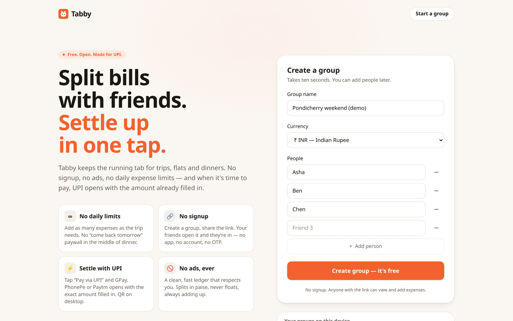<br /><sub><b>Create a group</b>: name, currency, people. No account.</sub></td>
    <td width="50%">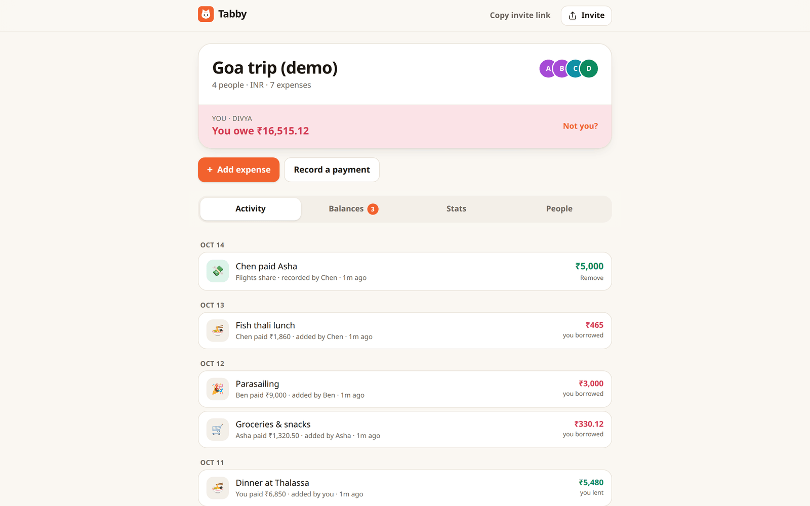<br /><sub><b>Group overview</b>: your balance and the activity feed</sub></td>
  </tr>
  <tr>
    <td>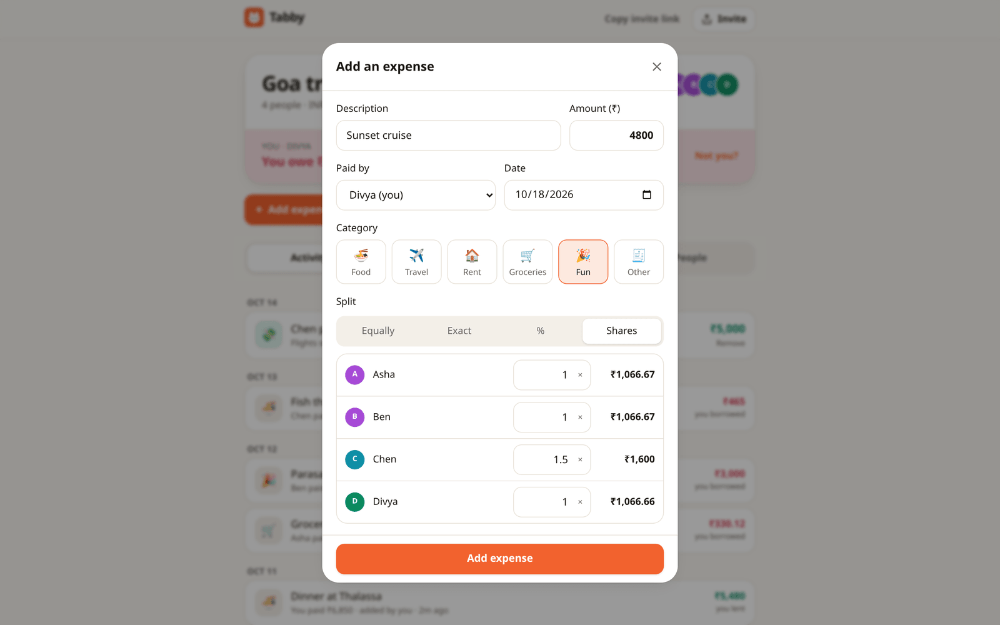<br /><sub><b>Add an expense</b>: equal, exact, % or shares, with a live preview</sub></td>
    <td>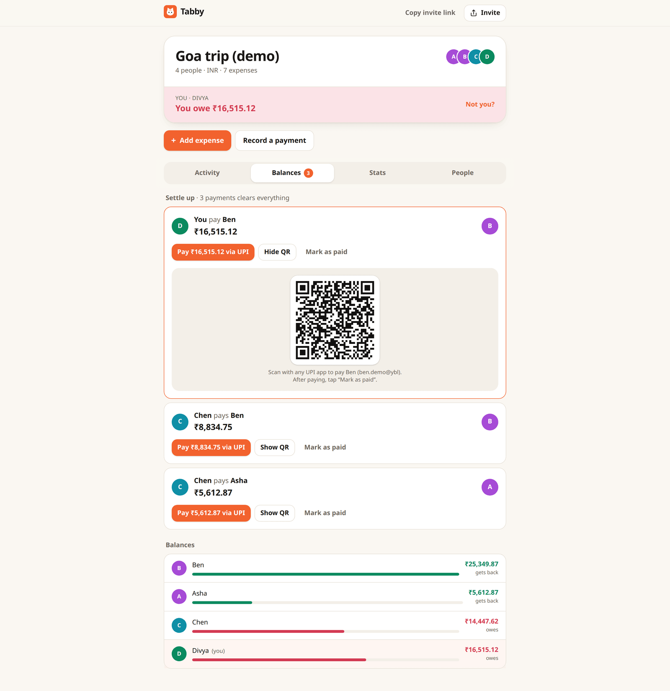<br /><sub><b>Settle up</b>: fewest payments, Pay via UPI, QR on desktop</sub></td>
  </tr>
  <tr>
    <td>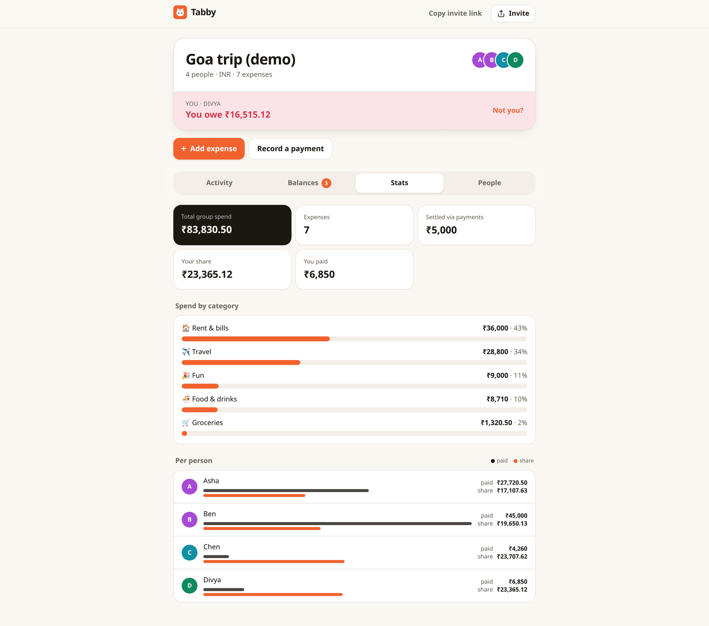<br /><sub><b>Stats</b>: spend by category, paid vs share per person</sub></td>
    <td>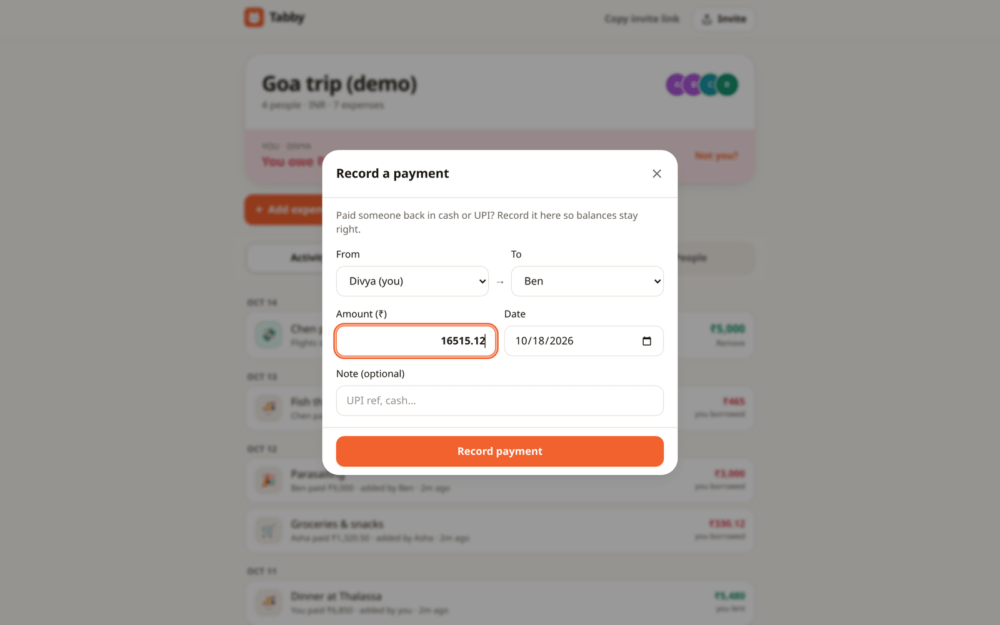<br /><sub><b>Record a payment</b>: prefilled from the settle-up plan</sub></td>
  </tr>
  <tr>
    <td>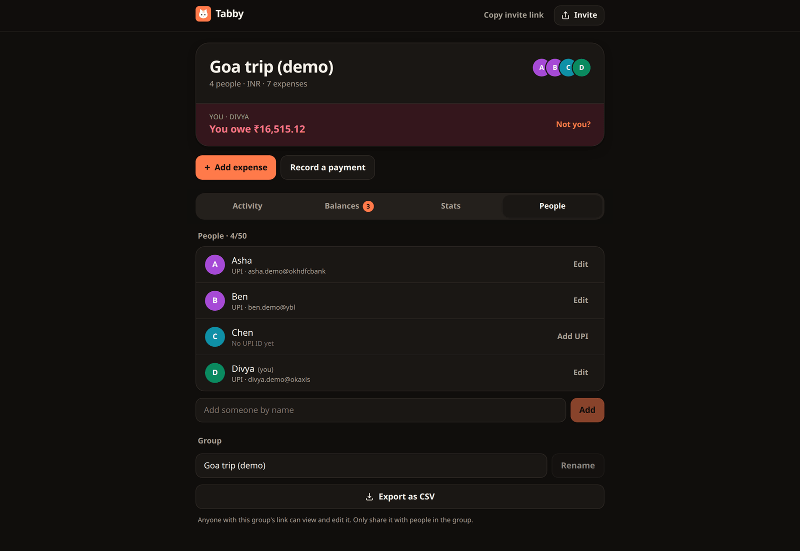<br /><sub><b>People</b>: UPI IDs, rename, CSV export (dark mode)</sub></td>
    <td>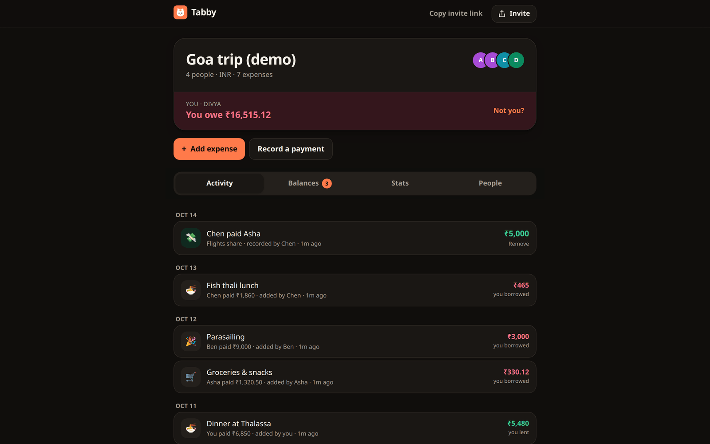<br /><sub><b>Dark mode</b>: follows your system setting</sub></td>
  </tr>
</table>

<table>
  <tr>
    <td align="center" width="33%">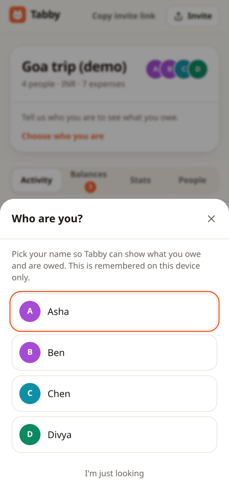<br /><sub>“Who are you?” picker</sub></td>
    <td align="center" width="33%">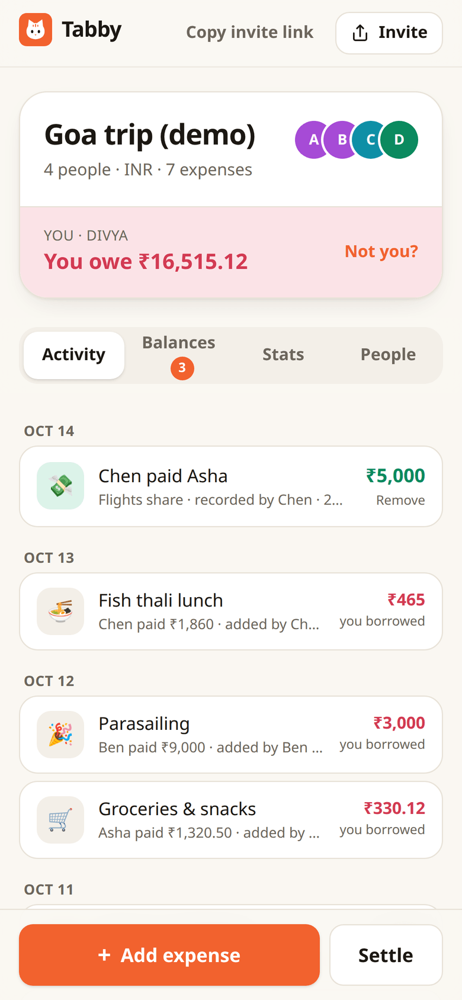<br /><sub>Mobile activity feed</sub></td>
    <td align="center" width="33%">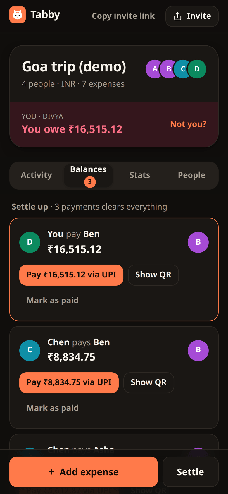<br /><sub>Mobile settle-up (dark)</sub></td>
  </tr>
</table>

<sub>All names, UPI IDs and amounts are fictional demo data.</sub>

## Features

- **No accounts.** Create a group (name, currency, 2–50 people). It lives at `/g/<id>`, where the id
  is 22 crypto-random URL-safe characters (132 bits). Anyone with the link can view and edit.
- **"Who are you?" picker**, remembered per group in `localStorage`, drives "you owe / you are owed".
- **Four split modes:** **equal** (choose who's in), **exact amounts**, **percentages**, **shares**
  (fractional shares allowed), plus description, amount, payer, date and category.
- **Exact money.** Amounts are stored as integer minor units (paise/cents). Proportional splits use the
  largest-remainder method, so they always add up exactly to the total and come out the same every time.
- **Settle up** with a greedy minimum-transactions plan (at most n−1 payments).
- **UPI built in.** Optional, validated UPI ID per member. In INR groups every settle-up row gets
  **Pay ₹X via UPI** (`upi://pay?pa=…&pn=…&am=…&cu=INR&tn=…`) and a QR code drawn in the browser for desktop.
- **Everything else you need:** record payments, an activity feed (newest first, who added what and
  when), stats (total spend, by category, paid vs share per person), CSV export, add/rename/remove
  people (removal is blocked while they appear in any expense or payment), rename the group.
- **Mobile-first UI** with light and dark themes via `prefers-color-scheme`, a PWA manifest and icons, and OG tags.
- **Abuse limits:** zod validation on every API route, 32 KB body cap, text length limits, at most
  ₹1 crore (or equivalent) per amount, 50 people, 5,000 expenses and 5,000 payments per group.
- **Open JSON API.** Everything the UI does goes through [12 documented endpoints](docs/api/README.md).

## Architecture

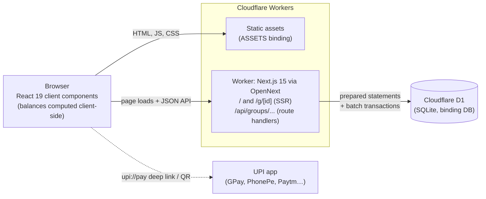

- The **Worker** is the Next.js app compiled by [`@opennextjs/cloudflare`](https://opennext.js.org/cloudflare).
  Pages are server-rendered on demand (all data lives in D1, so there's no incremental cache).
- **D1** is reached through `getCloudflareContext().env.DB` ([`src/lib/db.ts`](src/lib/db.ts)) with
  plain prepared statements; no ORM. Multi-row writes go through `db.batch()`, which is transactional.
- **Split amounts are computed on the server** when an expense is saved. **Balances and the settle-up
  plan are computed in the browser** from the group payload (and on the server only for CSV export).
- **Payments never touch Tabby.** The UPI link opens the payer's UPI app; the payment is recorded when
  someone taps **Mark as paid** and confirms the prefilled **Record a payment** form.

## Tech stack

| Layer | Choice |
| --- | --- |
| Framework | Next.js 15 (App Router), React 19, TypeScript 5 |
| Styling | Tailwind CSS v4 |
| Runtime | Cloudflare Workers via `@opennextjs/cloudflare` (`nodejs_compat`) |
| Database | Cloudflare D1 (SQLite), SQL migrations in [`migrations/`](migrations) |
| Validation | zod 4 |
| QR codes | `qrcode`, rendered in the browser |
| Tests | Vitest |
| Tooling | Wrangler 4, ESLint 9 |

## Quick start

Requires **Node.js 22+** (Wrangler 4 needs it; see [`.nvmrc`](.nvmrc)). No Cloudflare account or login
is needed for local development.

```bash
git clone https://github.com/amanjhacodes55/tabby.git
cd tabby
nvm use            # Node 22
npm install
npm run db:migrate:local   # = wrangler d1 migrations apply tabby --local (SQLite under .wrangler/)
npm run preview            # builds with OpenNext and serves the real Worker on http://localhost:8787
```

Alternatively, `npm run dev` runs `next dev` on http://localhost:3000 with hot reload. `next.config.ts`
calls `initOpenNextCloudflareForDev()`, so the `DB` binding is proxied to the same local D1 database.

To use a different port for the preview: `npx opennextjs-cloudflare build && npx opennextjs-cloudflare preview --port 8790`.

### Scripts

| Script | What it does |
| --- | --- |
| `npm run dev` | `next dev` with local D1 bindings |
| `npm run preview` | OpenNext build + `wrangler dev` (workerd, local D1) |
| `npm test` | Vitest unit tests |
| `npm run typecheck` | `tsc --noEmit` |
| `npm run lint` | ESLint |
| `npm run db:migrate:local` / `db:migrate:remote` | Apply D1 migrations locally / to Cloudflare |
| `npm run deploy` | OpenNext build + deploy to Cloudflare Workers |
| `npm run upload` | OpenNext build + upload a new version without deploying it |
| `npm run cf-typegen` | Regenerate `cloudflare-env.d.ts` from `wrangler.jsonc` |

## Configuration

Tabby needs **no secrets and no environment variables**: nothing in `src/` reads `process.env`. All
configuration is in Cloudflare bindings declared in [`wrangler.jsonc`](wrangler.jsonc) and typed in
[`cloudflare-env.d.ts`](cloudflare-env.d.ts):

| Binding | Type | Used for | Configured in |
| --- | --- | --- | --- |
| `DB` | D1 database (`database_name: "tabby"`) | All data, via `getCloudflareContext().env.DB` in `src/lib/db.ts` | `d1_databases[0]`; set `database_id` to your own database |
| `ASSETS` | Static assets (`.open-next/assets`) | JS/CSS/icons served by the Worker | `assets` (managed by OpenNext) |

Other `wrangler.jsonc` settings: `main: .open-next/worker.js`, `compatibility_flags: ["nodejs_compat",
"global_fetch_strictly_public"]`, and `observability.enabled: true` for Workers Logs.

## Deploying to Cloudflare Workers

You need a Cloudflare account (the free plan works).

```bash
npx wrangler login
npx wrangler d1 create tabby              # prints a database_id
```

Put that id in `wrangler.jsonc` → `d1_databases[0].database_id` (the value in the repo is the
author's database, so replace it), then:

```bash
npm run db:migrate:remote                 # wrangler d1 migrations apply tabby --remote
npm run deploy                            # opennextjs-cloudflare build && opennextjs-cloudflare deploy
```

Wrangler prints your `*.workers.dev` URL. To use your own domain, add a route or custom domain in the
Cloudflare dashboard. For later schema changes, add a numbered SQL file to `migrations/` and run
`npm run db:migrate:remote` before deploying code that depends on it.

## Project structure

```
src/
  app/
    page.tsx                 landing page + create-group form
    g/[id]/page.tsx          group page (SSR, noindex)
    api/groups/...           JSON API route handlers (see docs/api)
    manifest.ts, robots.ts   PWA manifest, robots.txt
  components/
    CreateGroupForm.tsx, RecentGroups.tsx, ui.tsx, toast.tsx
    group/                   GroupApp (tabs), ActivityFeed, BalancesView, StatsView,
                             MembersView, ExpenseForm, PaymentForm, IdentityPicker, QrCode
  lib/
    split.ts                 split math (largest remainder, BigInt-safe)
    balances.ts              net balances + greedy settle-up
    money.ts, currency.ts    decimal parsing/formatting, supported currencies
    upi.ts                   UPI ID validation + deep link builder
    csv.ts                   CSV export
    schemas.ts, limits.ts    zod request schemas and limits
    api.ts                   JSON helpers, body-size cap, uniform error handling
    db.ts                    D1 access and group loading
    *.test.ts                Vitest suites
migrations/                  D1 SQL migrations
public/                      icons, OG image
docs/                        API reference, screenshots
```

## Data model

One migration, [`migrations/0001_init.sql`](migrations/0001_init.sql). All money columns are
`INTEGER` minor units.

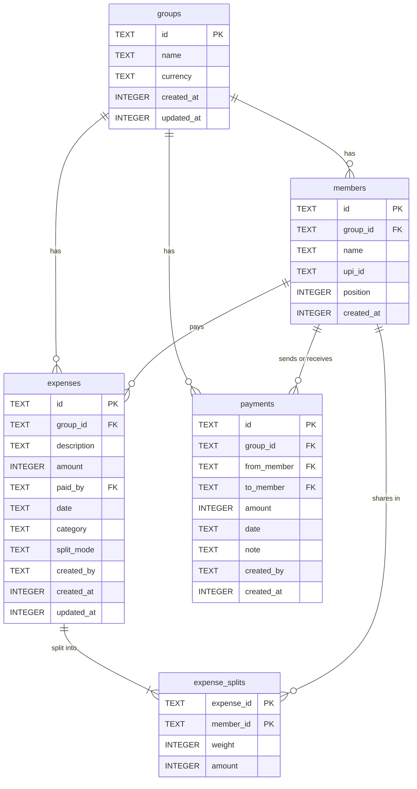

- `expense_splits.weight` keeps the raw input (1 for equal, minor units for exact, basis points for
  percent, hundredths of a share for shares) so edits round-trip exactly; `amount` is the computed share.
- `date` columns are `YYYY-MM-DD`; `created_at`/`updated_at` are epoch milliseconds.
- `created_by` is the self-reported member who added the row (no foreign key).

## How splits and balances are computed

1. **Splits** ([`src/lib/split.ts`](src/lib/split.ts)): equal, percent and shares use the
   largest-remainder method. Everyone gets `floor(total × weight / Σweight)`, then leftover paise go
   one each to the largest remainders (ties by input order). ₹1,320.50 split four ways is
   ₹330.13 + ₹330.13 + ₹330.12 + ₹330.12. Exact splits must sum to the total and percentages to 100%.
2. **Balances** ([`src/lib/balances.ts`](src/lib/balances.ts)): the payer is credited the full amount
   and each participant is debited their share. A payment credits the sender and debits the receiver.
   Positive means the group owes you.
3. **Settle up:** repeatedly match the largest debtor with the largest creditor for
   `min(debt, credit)`, ties broken by member order. That's at most n−1 transfers, and the plan is the
   same on every device.

Details and a worked example: [docs/api/balances.md](docs/api/balances.md).

## API

All reads and writes go through a small JSON API with no authentication: the group id is the
credential. **[Full API reference →](docs/api/README.md)**

| | |
| --- | --- |
| [Groups](docs/api/groups.md) | `POST /api/groups`, `GET`/`PATCH /api/groups/{id}` |
| [Members](docs/api/members.md) | `POST …/members`, `PATCH`/`DELETE …/members/{memberId}` |
| [Expenses](docs/api/expenses.md) | `POST …/expenses`, `PUT`/`DELETE …/expenses/{expenseId}` |
| [Payments](docs/api/payments.md) | `POST …/payments`, `DELETE …/payments/{paymentId}` |
| [CSV export](docs/api/export.md) | `GET …/export` |
| [Balances & settle-up](docs/api/balances.md) | computed from `GET /api/groups/{id}` (no endpoint) |

## Testing

```bash
npm test             # vitest: split math, settle-up, money parsing, UPI links, CSV
npm run typecheck
npm run lint
```

Unit tests live next to the code (`src/lib/*.test.ts`) and cover the pure logic: largest-remainder
allocation, all split modes, balances and settle-up, decimal parsing and formatting, UPI link
encoding, and CSV output including formula-injection escaping. Route handlers and UI have no
automated tests yet; check them by hand with `npm run preview`.

## Security model

Like Tricount, a group's link is its password: whoever holds it can read and edit the group. Ids are
unguessable, group pages send `noindex`, and `/g/` and `/api/` are disallowed in `robots.txt`. There
are no accounts, so there is no per-user authorization or audit trail beyond the "added by" label
(which is self-reported). There is no application-level rate limiting.

To report a vulnerability, see [SECURITY.md](SECURITY.md).

## Contributing

Issues and pull requests are welcome. See [CONTRIBUTING.md](CONTRIBUTING.md) for setup, checks and
the PR checklist.

## ☕ Buy me a coffee

I build Tabby on my own time and keep it free for everyone. If it saved you time, taught you something, or powers
something you're building, a coffee is the kindest way to say thanks, and every one buys me more hours to build
and improve Tabby and my other open-source projects.

**UPI: +91 8941951465**. Pay from any UPI app (Google Pay, PhonePe, Paytm, BHIM); international payments are
welcome too.

However small, every coffee keeps the work going. Thank you!

## License

Tabby is free and open-source software, licensed under the **GNU Affero General Public License v3.0 or later** ([AGPL-3.0-or-later](LICENSE)).

You can use, study, share and modify it for any purpose, including commercially. If you distribute a modified version, **or run one as a service that others use over a network**, you must publish your changes under the same license so the community benefits too.

Copyright © 2026 Aman Jha
